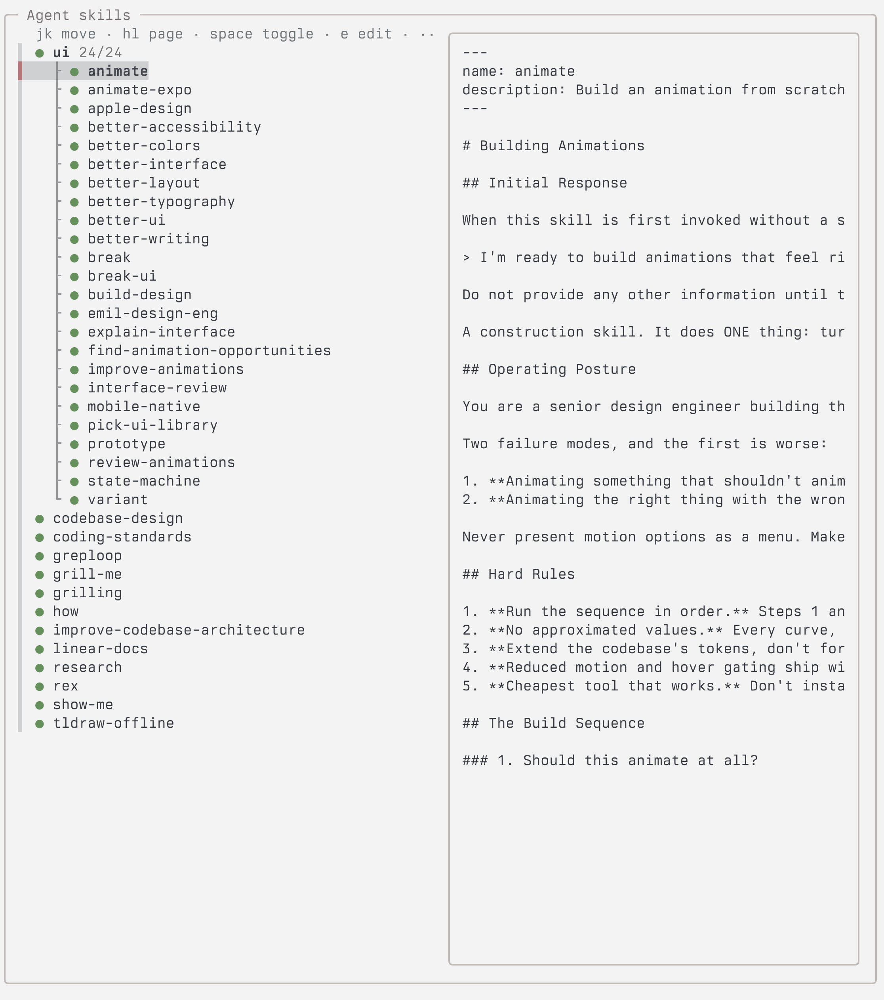

# skillswitch

Turn agent skills on and off for every coding agent at once (Claude Code, Codex, OpenCode, Cursor, Pi, …).



It works on the shared skills folder (`~/.agents/skills`): a skill is off when its `SKILL.md` is renamed to `SKILL.md.disabled`, so no agent loads it.

## Install

Requires `zsh` and `fzf`.

```sh
ln -s "$PWD/sks" ~/.local/bin/sks
```

## Usage

```sh
sks                  # picker: jk move · hl page · space toggle · e edit · q quit
sks ls               # list categories and skills with their state
sks off ui           # turn off a category (or "@ui")
sks edit             # edit categories in $EDITOR
sks on better-ui how # turn on skills
```

● on · ● off · ● category partly on. Toggling a category turns all its skills on, or all off when they're already all on.

## Categories

Define categories in `~/.agents/skill-categories`, one per line, with skill names or globs. Skills appear under each category they match; the rest are listed flat below.

```
ui: animate* better-* apple-design
```

Override paths with `SKILLS_DIR` and `SKILLS_CATEGORIES`.
